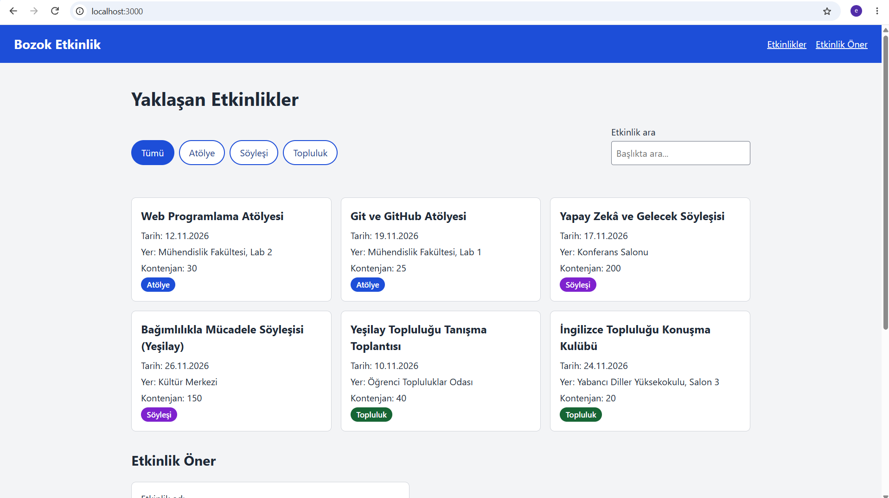

# Kampüs Etkinlik Panosu

BMH231 Web Programlama dersi Ödev 2 için geliştirilen küçük bir web uygulamasıdır.
Kampüs etkinliklerini listeler; etkinlikler Node.js ile yazılmış bir JSON API'den
`fetch` ile çekilir. Ön yüzde HTML, CSS ve JavaScript kullanılmıştır (framework yok);
sunucu yalnızca Node.js'in `http`, `fs` ve `path` modülleriyle yazılmıştır.

## Özellikler

- Etkinlikleri kart olarak listeleme
- Türe göre filtreleme (Atölye, Söyleşi, Topluluk) ve başlıkta arama
- Etkinlik öneri formu ve istemci tarafı doğrulama
- Duyarlı (responsive) tasarım

## Kurulum ve çalıştırma

Node.js (LTS) ve Git kurulu olmalıdır.

```
git clone https://github.com/EcemErgel/bmh231-odev2.git
cd bmh231-odev2
npm start
```

Ardından tarayıcıda http://localhost:3000 adresini açın.


## API uç noktaları

| Yöntem | Yol | Durum | Açıklama |
|---|---|---|---|
| GET | `/` ve `public/` altındaki dosyalar | 200 / 404 | Ön yüz dosyaları |
| GET | `/api/etkinlikler` | 200 | Tüm etkinlikler (JSON) |
| GET | `/api/etkinlikler?tur=atolye` | 200 | Türe göre süzülmüş etkinlikler |
| GET | `/api/etkinlikler/3` | 200 | Tek etkinlik |
| GET | `/api/etkinlikler/999` | 404 | `{"hata": "Etkinlik bulunamadı"}` |
| GET dışındaki yöntemler | herhangi | 405 | `Allow: GET` başlığı |

## Ekran görüntüsü

